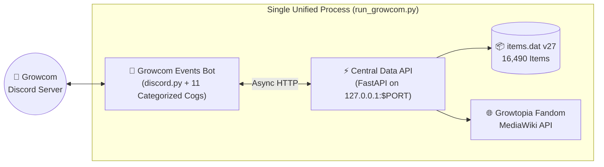

<h1 align="center">🌱 Growcom Events by Manwel</h1>
<h3 align="center">The Ultimate All-in-One Growtopia Utility, Automation & Encyclopedia Bot</h3>

<p align="center">
  
  
  
  
</p>

<p align="center">
  <i>Purpose-built by <b>Manwel</b> for the <b>Growcom</b> Growtopia Discord Community — combining real-time <code>items.dat</code> v27 binary parsing, <code>.rttex</code> pixel-art sprite extraction, automated 1:00 PM Daily Reset boards, and 11 categorized player tools.</i>
</p>

---

## ✨ Complete Suite of 11 Categorized Growtopia Tools

Every tool in **Growcom Events by Manwel** lives in its own isolated module inside [`bots/event-bot/src/cogs/`](bots/event-bot/src/cogs/), features a **2-minute per-user anti-spam cooldown**, and can be locked to its own dedicated Discord channel by Server Admins:

| # | Category & Module | Player Command | Admin Channel Lock | What It Does |
| :---: | :--- | :--- | :--- | :--- |
| **1** | 🌅 **Daily Reset & Auto-DQ** (`cogs/daily_events.py`) | `/daily` | `/set_daily_channel` • `/set_dq_feed_channel` • `/set_daily` | Auto-publishes the **1:00 PM (`00:00 GT`) Daily Reset Board** (Role Day rotation, Daily Challenge, & Crazy Jim's Daily Quest) and auto-reads `#dq-feed`. |
| **2** | 🌱 **Harvest Timer & Calculator** (`cogs/harvest_calculator.py`) | `/harvest` | `/set_harvest_channel` | Interactive modal asking when you planted & how many trees; calculates exact **Ready Time**, **XP**, **Gems**, and **auto-pings you** when ready! |
| **3** | 📦 **Item Stats Encyclopedia** (`cogs/item_lookup.py`) | `/item` | `/set_item_channel` | Instant lookup across all **16,490 Growtopia items**: Item ID, Rarity, Grow Time, Fist/Pickaxe Hits, Gems Drop, Chi, & `.rttex` Sprite. |
| **4** | 🧬 **Splicing & Recipe Lookup** (`cogs/recipe_lookup.py`) | `/recipe` | `/set_recipe_channel` | Shows exact **Seed Splicing (`Seed A + Seed B`)** and **Chemical Combiner / Forge / Cooking** crafting formulas. |
| **5** | 💰 **Trade & Rate Calculator** (`cogs/rate_calculator.py`) | `/rate` | `/set_rate_channel` | Calculates exact **BGL + DL + WL** breakdowns, `200`-item stack counts, and nearest whole-lock trades (`10/1 WL`, `200/1 DL`, `5 WL each`). |
| **6** | 🩺 **Surgery & Malady Assistant** (`cogs/surgery_helper.py`) | `/surgery` | `/set_surgery_channel` | Complete step-by-step cheat-sheet for all **27 Standard Illnesses & Vile Vial Maladies** (`Scalpel` count, tool order, & emergency priority buttons). |
| **7** | ⚖️ **Farmable Comparator** (`cogs/farm_compare.py`) | `/compare_farm` | `/set_compare_channel` | Side-by-side comparison of any 2 farmables (`Rarity`, `Grow Time`, `Pickaxe Punches`, `Gems`, `XP`, & Head-to-Head Verdict). |
| **8** | 🌳 **Recursive Mass Planner** (`cogs/mass_planner.py`) | `/mass` | `/set_mass_channel` | Recursively traces multi-tier seed splicing trees down to base seeds, calculating exact seed shopping lists & sequential grow times. |
| **9** | 🍳 **Cooking Oven Assistant** (`cogs/cooking_helper.py`) | `/cook` | `/set_cook_channel` | Exact **second-by-second Home Oven timelines** (`00s ➔ 16s ➔ 30s ➔ 50s`), heat settings, multi-oven shopping lists, & live countdown button. |
| **10** | 🦸 **Crimefighter Counter Guide** (`cogs/crime_helper.py`) | `/crime` | `/set_crime_channel` | Recommended **5-Card Deck**, elemental immunities, and turn-by-turn counter rotations for every Supervillain (*Dr. Destructo*, *Dragonhand*, etc.). |
| **11** | 🎣 **Fishing & Star Captain Guides** (`cogs/fishing_guide.py` & `cogs/star_captain.py`) | `/fish` • `/startrek` | `/set_fish_channel` • `/set_startrek_channel` | Complete **Fishing Lure & Fish Port Training** guide (`/fish`) and **Starship Bridge Station & Sector** cheat-sheet (`/startrek`). |

---

## 🏗️ System Architecture



### 📂 Repository Structure

```text
growcom/
├── bots/
│   ├── shared/
│   │   └── api_client.py               # Async httpx client for the Central Data API
│   └── event-bot/
│       ├── data/
│       │   ├── daily_state.json        # Persisted channel locks & daily board message ID
│       │   └── harvest_reminders.json  # Active player farm timers
│       └── src/
│           ├── bot.py                  # Main entrypoint + 2-minute per-user cooldown gatekeeper
│           ├── utils/
│           │   └── helpers.py          # State loaders, admin checks, & time parsers
│           └── cogs/                   # 11 Categorized Growtopia Tool Modules
│               ├── cooking_helper.py
│               ├── crime_helper.py
│               ├── daily_events.py
│               ├── farm_compare.py
│               ├── fishing_guide.py
│               ├── harvest_calculator.py
│               ├── item_lookup.py
│               ├── mass_planner.py
│               ├── rate_calculator.py
│               ├── recipe_lookup.py
│               ├── star_captain.py
│               └── surgery_helper.py
├── services/
│   └── central-data-api/
│       ├── data/
│       │   └── items.dat               # Official Growtopia items.dat v27 (16,490 items)
│       └── app/
│           ├── main.py                 # FastAPI service (/api/v1/items, /wiki, /convert, /health)
│           └── core/
│               ├── items_parser.py     # Extended v22–v27 items.dat binary parser
│               ├── rttex_engine.py     # .rttex <-> .png converter & sprite upscaler
│               └── wiki_scraper.py     # MediaWiki scraper & 1:00 PM Daily Reset calculator
├── Dockerfile                          # Cloud-ready container image
├── render.yaml                         # One-click Free Render.com deployment blueprint
├── requirements.txt                    # Python dependencies
└── run_growcom.py                      # Unified launcher for Local & Free Cloud hosting
```

---

## 🚀 Running Locally

1. **Create & activate virtual environment:**
   ```powershell
   python -m venv .venv
   .\.venv\Scripts\activate
   pip install -r requirements.txt
   ```
2. **Configure `.env`:**
   Copy `.env.example` to `.env` and set your `EVENT_BOT_TOKEN` and `DEV_GUILD_ID`.
3. **Start the entire ecosystem with one command:**
   ```powershell
   python -u run_growcom.py
   ```

---

## ☁️ 100% Free 24/7 Cloud Deployment (Render.com + UptimeRobot)

Because `run_growcom.py` runs **both** the FastAPI Central Data API (listening on `$PORT`) and the `Growcom Events` Discord bot inside a **single process**, you can host the entire project **100% FREE** on **Render.com's Free Web Service**!

1. **Push this repository to your GitHub account** *(your `.env` file is automatically protected by `.gitignore` so your token stays private)*.
2. Go to **[Render.com](https://render.com)** (Free account) ➔ **New +** ➔ **Web Service** and connect your GitHub repository.
3. Choose the **Free (`$0/month`)** instance type:
   * **Runtime:** `Python 3` (or `Docker`)
   * **Build Command:** `pip install -r requirements.txt`
   * **Start Command:** `python -u run_growcom.py`
4. Under **Environment Variables**, add:
   * `EVENT_BOT_TOKEN` = *(Your Discord Bot Token)*
   * `DEV_GUILD_ID` = `1567168949584658534`
   * `DAILY_EVENTS_CHANNEL_ID` = `1567193422157054093`
   * `EVENT_TIMEZONE` = `Asia/Manila`
5. **Keep it awake 24/7 for free:** Copy your Render URL (`https://<your-app>.onrender.com/api/v1/health`) and add a free 5-minute HTTP monitor on **[UptimeRobot.com](https://uptimerobot.com)** so your free container never sleeps!

---

<p align="center">
  <b>Growcom Events by Manwel</b> • Built with ❤️ for the Growtopia Community
</p>
